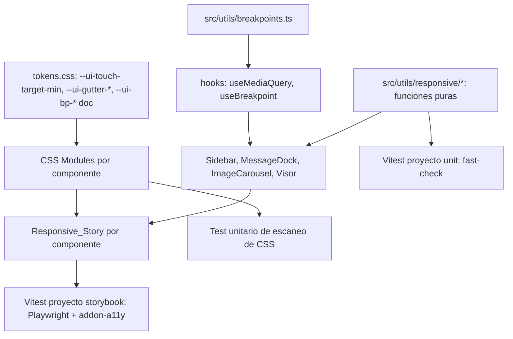

# Design Document

## Overview

Este diseño hace responsiva la librería `@ai27-tech/ui` (repo `pf-library-frontend-components`) con un único conjunto de breakpoints, tamaños táctiles mínimos, stories de Storybook por viewport y una suite automatizada en navegador real. Cubre los 12 requisitos de `requirements.md`.

Decisiones principales:

| # | Decisión | Motivo |
| --- | --- | --- |
| D1 | Los breakpoints se escriben como literales `rem` en `@media` y `@container`. Los tokens `--ui-bp-*` solo documentan. | Las propiedades personalizadas de CSS no se pueden usar dentro de la condición de `@media`/`@container`. Un test unitario escanea el CSS y falla si aparece otro valor (Req 1.6, 1.9). |
| D2 | Constantes equivalentes en TypeScript (`src/utils/breakpoints.ts`) para la lógica que necesita JS (Sidebar, Dock, carrusel). | Una sola fuente en JS; un test verifica que coincide con los literales del CSS. |
| D3 | CSS primero. JS solo donde CSS no alcanza: foco y estado del Sidebar móvil, gestos, reposicionamiento de paneles, Dock. | Menos código y sin parpadeo de primer render. |
| D4 | La lógica con reglas numéricas o de estado se extrae a funciones puras en `src/utils/responsive/`. | Se prueban con propiedades sin navegador. |
| D5 | Sin API rota. Toda prop nueva es opcional; en escritorio la salida es idéntica a la actual (Req 12). | Los portales actualizan sin migrar. |
| D6 | Los componentes que dependen del ancho de su contenedor (`Table` apilada, `Timeline`) usan `@container`. El resto usa `@media`. | Coincide con el Req 1.5. Ver pendiente P1 para `Grid`. |

### Investigación

- Chromium aplica `(pointer: coarse)` en Playwright con `hasTouch: true` y `isMobile: true` en el contexto del navegador. Se usa para el Req 9 y 11.3.
- `100dvh` y `env(safe-area-inset-bottom)` están disponibles en los navegadores objetivo; se declara `100vh` como valor previo para navegadores sin `dvh`.
- El teclado en pantalla se detecta con `window.visualViewport` (`height`, `offsetTop`). Playwright no emula el teclado, así que el Req 8.5 se verifica con una story que reduce `visualViewport` de forma simulada y con revisión manual en dispositivo.
- WCAG 2.2: 2.5.8 (AA, 24 px) y 2.5.5 (AAA, 44 px). El diseño apunta a 44 px solo con puntero grueso, como indica `requirements.md`.
- Storybook 10.6: los viewports se declaran en `parameters.viewport.options` y se eligen por story con `globals.viewport` (API de `storybook/viewport`). Se verificará al implementar contra la documentación de la versión instalada.

## Architecture



Dos proyectos de Vitest ya existen en `vite.config.ts`: `unit` (jsdom) y `storybook` (Chromium). Este diseño agrega pruebas a ambos y un script npm para el segundo en CI (hoy queda fuera del CI de PR).

### Breakpoint_Set

| Nombre | Rango | rem | px |
| --- | --- | --- | --- |
| `mobile` | menor a 40rem | `< 40rem` | `< 640` |
| `tablet` | de 40rem a menos de 64rem | `40rem` a `< 64rem` | `640` a `< 1024` |
| `desktop` | 64rem o más | `>= 64rem` | `>= 1024` |

Condiciones permitidas en CSS (únicas): `(max-width: 39.99rem)` para móvil, `(min-width: 40rem) and (max-width: 63.99rem)` para tablet, `(min-width: 64rem)` para escritorio, y los mismos valores en `@container`.

Los `@media` actuales con 560, 640, 768 y 1024 px, y `40rem` se migran a estos valores (ver Components and Interfaces, tabla de migración). Los umbrales `max-width: 40rem` de `PageHeader` pasan a `39.99rem`.

## Components and Interfaces

### Tokens (`src/styles/tokens.css`)

```css
:root {
  --ui-touch-target-min: 2.75rem;      /* Req 1.2 */
  --ui-gutter-screen: var(--ui-space-4);   /* móvil */
  /* documentación de breakpoints (no usables en @media) */
  --ui-bp-tablet: 40rem;
  --ui-bp-desktop: 64rem;
}
@media (min-width: 40rem) { :root { --ui-gutter-screen: var(--ui-space-5); } }
@media (min-width: 64rem) { :root { --ui-gutter-screen: var(--ui-space-6); } }
```

`--ui-space-1` a `--ui-space-6` no cambian (Req 1.3). Los valores de `--ui-gutter-screen` son una propuesta (supuesto S3).

### Utilidades compartidas

| Archivo | Contenido |
| --- | --- |
| `src/utils/breakpoints.ts` | `BREAKPOINTS`, `type Breakpoint = 'mobile' \| 'tablet' \| 'desktop'`, `getBreakpoint(widthPx)` |
| `src/utils/useMediaQuery.ts` | `useMediaQuery(query: string): boolean` con `useSyncExternalStore` y `matchMedia`. En servidor devuelve `false`. |
| `src/utils/useBreakpoint.ts` | `useBreakpoint(): Breakpoint` sobre `useMediaQuery` |
| `src/utils/useFocusTrap.ts` | `useFocusTrap(ref, active)`: Tab y Mayús+Tab cíclicos dentro del contenedor |
| `src/utils/responsive/columns.ts` | `capColumns`, `resolveResponsiveColumns` |
| `src/utils/responsive/pagination.ts` | `getPaginationItems` |
| `src/utils/responsive/position.ts` | `clampToViewport` |
| `src/utils/responsive/swipe.ts` | `nextIndexOnSwipe` |
| `src/components/MessagePanel/dockState.ts` | `dockReducer` (extrae la lógica de `useMessageDock`) |

Firmas de las funciones puras:

```ts
export type Breakpoint = 'mobile' | 'tablet' | 'desktop';
export function getBreakpoint(widthPx: number): Breakpoint;

export type ResponsiveColumns = number | Partial<Record<Breakpoint, number>>;
// Req 2.1-2.3: tope por breakpoint cuando se pasa un número; fallback hacia el menor definido cuando se pasa un mapa
export function resolveResponsiveColumns(columns: ResponsiveColumns, bp: Breakpoint): number;
// Req 7.1-7.3: min(requested, caps[bp])
export function capColumns(requested: number, bp: Breakpoint, caps: Record<Breakpoint, number>): number;

export type PaginationItem = number | 'ellipsis';
export function getPaginationItems(page: number, total: number, maxItems: number): PaginationItem[];

export interface Rect { top: number; left: number; width: number; height: number }
export function clampToViewport(anchor: Rect, panel: { width: number; height: number },
  viewport: { width: number; height: number }, margin: number): { top: number; left: number; maxHeight: number };

export function nextIndexOnSwipe(index: number, count: number, deltaX: number, threshold: number): number;
```

### Cambios por componente

Las props nuevas son opcionales. «Escritorio sin cambio» significa que el CSS nuevo solo vive dentro de las condiciones móvil o tablet, o se activa con la prop nueva.

#### Estructura de pantalla (Req 2)

| Componente | Cambio |
| --- | --- |
| `Grid` | `columns` acepta `number \| Partial<Record<Breakpoint, number>>`. El CSS define `--ui-grid-cols-mobile/-tablet/-desktop`; con número, móvil=1, tablet=`min(n,2)`, escritorio=`n`. Con mapa se aplica `resolveResponsiveColumns`. `minItemWidth` no cambia. |
| `PageHeader` | `@media (max-width: 39.99rem)`: apila título, descripción y acciones. `Breadcrumb` ya admite `maxItems`; se agrega `min-width: 0` y `overflow-wrap: anywhere` para evitar desborde. |
| `Tabs` | `TabList` ya desplaza. Al activar una pestaña, `scrollIntoView({ inline: 'nearest', block: 'nearest' })` mantiene visible la activa (2.6). |
| `Section` | `padding-inline: var(--ui-gutter-screen)` solo en móvil. |
| `Card`, `CardFooter` | `min-width: 0`, `overflow-wrap: anywhere`. En móvil `CardFooter` pasa a columna con hijos `width: 100%`. |
| `Stack`, `Inline`, `Divider`, `EmptyState` | `min-width: 0`; `Inline` con `flex-wrap: wrap` (2.10). |

#### Navegación (Req 3)

`Sidebar` nuevas props opcionales:

```ts
interface SidebarProps {
  /** Panel superpuesto abierto en móvil (controlado). */
  mobileOpen?: boolean;
  onMobileOpenChange?: (open: boolean) => void;
  /** Si es true (por defecto), en tablet arranca contraído. Solo afecta cuando `collapsed` no se pasa. */
  autoCollapseOnTablet?: boolean;
}
export function SidebarTrigger(props: { onClick?: () => void; 'aria-label'?: string }): JSX.Element; // botón de apertura, Touch_Target 44px
```

- Móvil: el `<nav>` se posiciona `fixed`, fuera de pantalla (`transform: translateX(-100%)`), y con `mobileOpen` se muestra con un fondo (`<div data-sidebar-backdrop>`) que cubre el área restante (3.1). `useFocusTrap` se activa solo con el panel abierto (3.4). Escape y clic en el fondo llaman `onMobileOpenChange(false)` y devuelven el foco al elemento guardado al abrir (3.5). Un clic en `SidebarItem` cierra el panel; el evento de navegación del consumidor no se detiene (3.6).
- Si `useBreakpoint()` deja de ser `mobile` con el panel abierto, un efecto llama `onMobileOpenChange(false)` y se retira el fondo y la trampa de foco (3.7).
- Tablet: sin la prop `collapsed`, el estado inicial es contraído según `useBreakpoint()`; con `collapsed` controlado se respeta el valor del consumidor.
- Escritorio: sin cambios (3.3). `aria-expanded` refleja abierto o contraído en todos los rangos (3.10).
- `Navbar`: el umbral `640px` pasa a `39.99rem`. El botón de menú (`.toggle`) ya existe; se verifica que el menú desplegado no desborde.
- `Breadcrumb`: se confirma en implementación que `maxItems` conserva primero y último; si el plegado no vive en una función pura, se prueba con ejemplos.

#### Datos y listas (Req 4)

| Componente | Cambio |
| --- | --- |
| `Table` | Nueva prop `responsive?: 'scroll' \| 'stacked'` (por defecto `'scroll'`, el comportamiento actual). Con `'stacked'`, el contenedor tiene `container-type: inline-size` y, con `@container (max-width: 39.99rem)`, cada `<tr>` se muestra como tarjeta usando `display: block` y un `data-label` en cada `<td>` que se imprime con `::before`. Sin filas se muestra `emptyState`. Orden, selección y expansión siguen operables con controles de 44 px en puntero grueso. Se mantiene la semántica accesible con `role` explícitos de tabla en las celdas, pues `display: block` pierde el rol nativo en algunos navegadores. |
| `FilterBar`, `FilterTable` | Una columna en móvil. Nueva prop `collapsibleOnMobile?: boolean` (por defecto `false`): un botón alterna los filtros, ocultos al inicio solo en móvil. |
| `Pagination` | En móvil usa `getPaginationItems(page, total, 5)`. En tablet y escritorio, el límite actual. |
| `DescriptionList` | `columns` se limita por CSS: móvil 1, tablet `min(columns,2)`. En móvil con `orientation="horizontal"`, nombre sobre valor. |
| `Stat`, `Badge` | `min-width: 0`; el valor numérico usa `overflow-wrap: anywhere` sin `text-overflow` (4.10). `Badge` envuelve o trunca con puntos suspensivos (4.13). |
| `Timeline` | Con `@container (max-width: 39.99rem)`, la alternada pasa a una columna. El umbral de alternada `@container (min-width: 40rem)` ya coincide. En horizontal, al montar se llama `scrollIntoView` sobre el punto actual (4.12). |

#### Formularios y controles (Req 5)

- `FormRow`: umbral `560px` → `39.99rem`. `FormField` horizontal: columna en móvil. `FormActions`: columna con `flex-direction: column-reverse` solo si el orden visual necesita invertirse; el DOM mantiene la acción principal primero para que el orden de tabulación coincida (5.3). Fijo abajo: `padding-bottom: env(safe-area-inset-bottom)`.
- `Input`, `Textarea`, `Select`: en móvil `min-height: var(--ui-touch-target-min)` y `font-size: 1rem` (evita el zoom automático de iOS). La lista de `Select searchable` usa `max-height: min(20rem, 60dvh)` con `overflow-y: auto`.
- `Checkbox`, `Radio`, `Switch`: la etiqueta envolvente se amplía a 44 px de alto en móvil con `min-height` y `padding-block`.
- `Calendar`: columnas `repeat(7, minmax(0, 1fr))` y celdas `aspect-ratio: 1` con `min-height` 44 px en puntero grueso (5.8).
- `DateInput`, `TimePicker`, `DateTimeInput`: el panel de presets pasa de columna lateral a apilado en móvil. El panel usa `clampToViewport` en cada apertura y en `resize`/`orientationchange`, con `max-height` y `overflow: auto` si no cabe (5.12, 5.13). `DateInput` quita su `min-width` con `@container (max-width: 12rem)`; `DateTimeInput` apila fecha y hora en móvil.

#### Avisos y superposiciones (Req 6)

- `Modal`: móvil `width: calc(100vw - 2 * var(--ui-space-4))`; `max-height: calc(100vh - 2 * var(--ui-space-4))` y luego `100dvh`. Encabezado y pie fijos y cuerpo con `overflow-y: auto`. Pie en columna en móvil. Por debajo de 320 px de viewport el diálogo conserva `min-width: calc(320px - 2 * var(--ui-space-4))` y el cuerpo desplaza en horizontal (6.11).
- `ToastContainer`: móvil `inline-size: calc(100vw - 2 * var(--ui-space-4))` y `inset-block-start/end: max(var(--ui-space-4), env(safe-area-inset-*))`.
- `Popover`: `max-width: calc(100vw - 2 * var(--ui-space-2))` y posición con `clampToViewport`.
- `Tooltip`: la coordenada horizontal pasa por `clampToViewport`, con ajuste a los bordes izquierdo y derecho.
- `Alert`: en móvil, columna para icono, mensaje y acciones.
- `Skeleton*`, `Spinner`, `ProgressBar`: `max-width: 100%`.
- Movimiento reducido: los CSS de `Modal`, `Toast`, `Popover`, `Tooltip` y `Alert` ya tienen o reciben `@media (prefers-reduced-motion: reduce)` (6.10). `Tooltip` y `Alert` hoy no lo tienen (se confirma en implementación con grep).

#### Imágenes (Req 7)

- `ImageGrid`: el estilo en línea de columnas se sustituye por variables CSS (`--ui-image-grid-cols`) y `capColumns(columns, bp, { mobile: 2, tablet: 3, desktop: columns })`. La vista de lista deja de usar la plantilla fija: en móvil cada elemento es un bloque apilado.
- `ImageCard`: umbral `640px` → `39.99rem`; `aspect-ratio` y `min-width: 0` en el contenedor de insignias.
- `ImageCarousel`: 1 elemento por vista en móvil. Gestos con Pointer Events (`pointerdown`/`pointerup`) y `nextIndexOnSwipe` con umbral de 40 px. `touch-action: pan-y` para no bloquear el desplazamiento vertical.
- `Visor`: `height: 100dvh` en móvil; mismos gestos; botones con `--ui-touch-target-min`; Escape y trampa de foco con `useFocusTrap` si hoy no la tiene (se verifica con grep antes de implementar, para no duplicar).

#### Mensajería (Req 8)

- `MessagePanel` y `MessageDock`: umbral `560px` → `39.99rem`. En móvil el panel abierto ocupa `100vw` y `100dvh` (con `visualViewport` ajustando el alto cuando el teclado está visible). La lógica de apertura se extrae a `dockReducer` con `maxOpen` según el breakpoint: móvil 1, tablet 1, escritorio el valor actual. Al abrir un segundo panel en móvil se minimiza el anterior sin borrar su `draft`.
- `MessageBubble`: `max-width: 85%` y `overflow-wrap: anywhere` en móvil.
- `MessageComposer`: `position: sticky; bottom: 0`, `padding-bottom: env(safe-area-inset-bottom)`, botones de 44 px con `gap: var(--ui-space-2)`.
- `MessageAttachment`: nombre con truncado que conserva la extensión (separar `base` y `.ext` en dos `<span>`; el `base` lleva `text-overflow: ellipsis`).
- `ConversationStatus`: columna en móvil.
- `MessageThread`: no se modifica el orden por `secuencia`; se agrega una prueba de regresión (8.9).

#### Accesibilidad táctil (Req 9)

Un bloque compartido en `src/styles/base.css`:

```css
@media (pointer: coarse) {
  .ui-touch { min-block-size: var(--ui-touch-target-min); min-inline-size: var(--ui-touch-target-min); }
}
```

Cada módulo CSS aplica `min-width/min-height: var(--ui-touch-target-min)` bajo `@media (pointer: coarse)` en sus controles listados en el Req 9.2. Donde el elemento visible no debe crecer (celdas densas), se amplía el área activable con un `::after` posicionado con `inset: calc((var(--ui-touch-target-min) - 100%) / -2)` y `pointer-events: auto`. Para que las áreas ampliadas no se solapen (9.4, 9.8), los controles contiguos usan `gap` mínimo de `var(--ui-space-2)` y el pseudoelemento se limita con `max()` a la mitad del `gap`.

### Storybook (Req 10)

`.storybook/preview.tsx`:

```ts
const VIEWPORTS = {
  mobile:  { name: 'Móvil',   styles: { width: '375px',  height: '667px' },  type: 'mobile' },
  tablet:  { name: 'Tablet',  styles: { width: '768px',  height: '1024px' }, type: 'tablet' },
  desktop: { name: 'Escritorio', styles: { width: '1280px', height: '800px' }, type: 'desktop' },
};
// parameters.viewport = { options: VIEWPORTS }
```

- Cada archivo `*.stories.tsx` recibe exports `Mobile` y, si corresponde, `Tablet`, con `globals: { viewport: { value: 'mobile' } }` y `parameters: { a11y: { test: 'error' }, responsive: true }`. La story existente no se toca (10.5).
- Contenido representativo: un módulo `src/stories/responsiveFixtures.ts` exporta `LONG_TOKEN` (más de 60 caracteres sin espacios), `LONG_NUMBER` (9 o más dígitos) y `makeItems(n >= 20)`.
- Página MDX `src/stories/Responsive.mdx` documenta el Breakpoint_Set, el Touch_Target y los pasos para elegir un viewport.
- Cobertura (10.3): un test unitario `responsive-coverage.test.ts` lee `src/index.ts`, los archivos `*.stories.tsx` y falla si algún componente exportado no tiene story `Mobile`. Reporta el nombre faltante.

### Verificación (Req 11)

| Comprobación | Dónde |
| --- | --- |
| Sin desborde horizontal en 320, 375, 768 y 1280 | Test `storybook` con un `play` o decorador común que redimensiona el contexto y compara `document.documentElement.scrollWidth <= clientWidth` |
| Touch_Target ≥ 44 px con puntero grueso | Mismo proyecto; contexto Playwright con `hasTouch` e `isMobile`; recorre elementos interactivos visibles y mide `getBoundingClientRect()`, descartando los que usan área ampliada (`[data-touch-extended]`) |
| a11y | `parameters.a11y.test = 'error'` solo en stories con `responsive: true`; las demás conservan `todo` (11.6) |
| Escaneo de CSS | Test unitario `breakpoints-css.test.ts`: extrae cada condición de `@media`/`@container` con `min-width`/`max-width` en `src/**/*.css` y falla indicando archivo y valor (1.6, 1.9) |
| Paridad TS y CSS | Mismo test compara `BREAKPOINTS` con los literales permitidos |
| CI | Nuevo script `test:responsive` (`vitest run --project storybook`) y paso en `.github/workflows` como check requerido (11.7). Se confirma el nombre del workflow al implementar. |

### Compatibilidad (Req 12)

- Props existentes sin cambios de nombre, tipo ni valor por defecto. `Grid.columns` amplía su tipo (`number` sigue válido).
- Pruebas: un `tsc` sobre fixtures de consumo de la versión anterior; comparación de capturas de las stories existentes a 1280 px (12.3); `grep` sobre `dist/` para confirmar que no aparece `@ai27-tech/contracts` (12.5).
- Versión: `0.3.0-beta.2` o `0.4.0-beta.1` según el CHANGELOG (12.6). Se propone el segundo porque cambia el comportamiento en anchos menores al de escritorio.

## Data Models

No hay persistencia. Los tipos nuevos son:

```ts
type Breakpoint = 'mobile' | 'tablet' | 'desktop';
type ResponsiveColumns = number | Partial<Record<Breakpoint, number>>;
type PaginationItem = number | 'ellipsis';

interface DockPanelState { id: string; open: boolean; draft: string }
interface DockState { panels: DockPanelState[]; maxOpen: number }
type DockAction =
  | { type: 'open'; id: string }
  | { type: 'minimize'; id: string }
  | { type: 'close'; id: string }
  | { type: 'draft'; id: string; value: string }
  | { type: 'setMaxOpen'; value: number };
```

`dockReducer(state, action): DockState` mantiene la invariante `panels.filter(p => p.open).length <= maxOpen`. Al abrir con el cupo lleno, minimiza el panel abierto más antiguo sin tocar su `draft`. Se confirma contra `useMessageDock` actual al implementar; si el hook usa otro modelo, el reductor lo envuelve y no cambia su API pública.

## Correctness Properties

*A property is a characteristic or behavior that should hold true across all valid executions of a system-essentially, a formal statement about what the system should do. Properties serve as the bridge between human-readable specifications and machine-verifiable correctness guarantees.*

La lógica visual (CSS, medidas, foco, gestos reales) no se prueba con propiedades; ver Testing Strategy. Las propiedades cubren las funciones puras y reductores de D4.

### Property 1: Clasificación de ancho en un único breakpoint

*For any* ancho `w >= 0`, `getBreakpoint(w)` devuelve exactamente uno de `mobile`, `tablet` o `desktop`; es `mobile` si `w < 640`, `tablet` si `640 <= w < 1024` y `desktop` si `w >= 1024`; y es monótona: si `a <= b` el índice de `getBreakpoint(a)` no es mayor que el de `getBreakpoint(b)`.

**Validates: Requirements 1.4, 2.1, 2.2**

### Property 2: Tope de columnas por breakpoint

*For any* `requested >= 1`, breakpoint y topes `caps`, `capColumns(requested, bp, caps)` es igual a `min(requested, caps[bp])`, nunca es menor que 1 y nunca supera `requested`. Con los topes de `Grid` (móvil 1, tablet 2) y de `ImageGrid` (móvil 2, tablet 3), y `requested` menor o igual al tope, devuelve `requested`.

**Validates: Requirements 2.1, 2.2, 7.1, 7.2, 7.3**

### Property 3: Fallback de columnas por breakpoint en `Grid`

*For any* mapa parcial de columnas por breakpoint y cualquier breakpoint activo, `resolveResponsiveColumns` devuelve el valor definido para ese breakpoint; si no existe, el del breakpoint definido inmediatamente menor; y si no existe ninguno, 1.

**Validates: Requirements 2.3**

### Property 4: Ventana de paginación acotada y con la página actual

*For any* `total >= 1`, `page` en `[1, total]` y `maxItems >= 5`, `getPaginationItems` devuelve como máximo `maxItems` elementos, incluye `page`, incluye 1 y `total`, y los números salen en orden ascendente sin repetirse.

**Validates: Requirements 4.6**

### Property 5: Paneles flotantes dentro del viewport

*For any* ancla, tamaño de panel, viewport y margen válidos, el resultado de `clampToViewport` deja los cuatro bordes del panel (con `maxHeight` aplicado) dentro del viewport menos el margen, y deja visible el ancla. Si el panel cabe sin ajuste, la posición no cambia (idempotencia: aplicar `clampToViewport` sobre su propio resultado devuelve el mismo resultado).

**Validates: Requirements 5.12, 5.13, 6.6, 6.7**

### Property 6: Deslizamiento limitado al rango

*For any* `count >= 1`, `index` en `[0, count - 1]`, `deltaX` y `threshold > 0`, `nextIndexOnSwipe` devuelve un índice en `[0, count - 1]` que difiere de `index` en 0 o en 1. Si `|deltaX| < threshold`, o si el desplazamiento sale del rango, devuelve `index`. Un `deltaX` negativo avanza y uno positivo retrocede.

**Validates: Requirements 7.7, 7.8, 7.10, 7.11**

### Property 7: El Dock respeta el cupo y conserva borradores

*For any* secuencia de acciones `open`, `minimize`, `close`, `draft` y `setMaxOpen` aplicada a `dockReducer`, el número de paneles abiertos no excede `maxOpen` después de cada acción, y todo panel que no se cierra explícitamente conserva el último `draft` escrito, incluso si se minimizó por otra apertura.

**Validates: Requirements 8.2, 8.3**

### Property 8: Orden de mensajes por `secuencia`

*For any* lista de mensajes con `secuencia` única y cualquier orden de `creadoEn`, y para cualquier breakpoint, los mensajes renderizados por `MessageThread` quedan en `secuencia` ascendente.

**Validates: Requirements 8.9**

### Property 9: La tabla apilada muestra todos los pares nombre-valor

*For any* lista de columnas visibles y de filas, `Table` con `responsive="stacked"` produce `filas × columnas visibles` pares nombre-valor, cada uno con el nombre de su columna; con cero filas produce el estado vacío y ningún par.

**Validates: Requirements 4.1, 4.14**

## Error Handling

| Situación | Tratamiento |
| --- | --- |
| `matchMedia` no existe (SSR, jsdom sin mock) | `useMediaQuery` devuelve `false`; el CSS gobierna la disposición. `vitest.setup.ts` agrega un mock de `matchMedia`. |
| `columns` menor a 1 o no entero en `Grid`/`ImageGrid` | Se normaliza con `Math.max(1, Math.floor(n))`. |
| `maxItems < 5` en `getPaginationItems` | Se usa 5 como mínimo. |
| Viewport menor que el panel o que el margen en `clampToViewport` | `maxHeight` y ancho se limitan al viewport menos el margen; el contenido desplaza internamente. |
| `ResizeObserver`/`visualViewport` ausentes | Se omite el ajuste dinámico; queda el CSS con `dvh`. |
| Cambio de breakpoint con Sidebar móvil abierto | Se cierra el panel, se quita el fondo y se libera la trampa de foco (3.7). |
| `build-storybook` falla por una story | Se conserva la salida de Storybook, que nombra la story (10.9); no se suprime el error. |
| Un componente no puede cumplir un requisito | Se registra la excepción con su motivo en `docs/responsive-excepciones.md` y en `CHANGELOG.md` (11.10). |

## Testing Strategy

**Enfoque dual.** Pruebas de propiedades para las funciones puras y reductores (Properties 1 a 8, y 9 con render en jsdom). Pruebas de ejemplo y de navegador para CSS, foco, gestos y medidas.

**PBT.** Se usa `fast-check` como devDependency (a agregar; versión fija) dentro del proyecto Vitest `unit`. No se implementa PBT desde cero. Cada propiedad es un solo test con `fc.assert(..., { numRuns: 100 })` (la Property 9 puede usar 25 por el costo de render) y lleva el comentario `// Feature: responsive-components-library, Property N: <texto>`.

**Pruebas unitarias (ejemplo).**
- Escaneo de CSS de breakpoints y paridad con `BREAKPOINTS` (1.6, 1.9).
- Cobertura de stories `Mobile` por componente exportado (10.3).
- `Sidebar`: abrir, Escape, clic en fondo, clic en ítem, cambio de ancho, trampa de foco con `user-event` (3.4 a 3.7).
- `labels` por defecto y personalizados (12.4).
- `Grid` en escritorio produce el mismo estilo que antes (12.2).

**Pruebas en navegador (proyecto `storybook`, Chromium con Playwright).**
- Sin desborde horizontal en 320, 375, 768 y 1280 px (2.5, 2.8, 2.10, 4.2, 6.9, 8.4, 11.2).
- Touch_Target de 44 px con puntero grueso y separación de 8 px (4.3, 9.1 a 9.4, 11.3).
- `addon-a11y` con `test: 'error'` en stories responsivas (11.4 a 11.6).
- Zoom de texto al 200% a 320 px (9.5) y cambio de orientación con estado conservado en menos de 300 ms (9.7).
- Posición de paneles de fecha y hora en bordes del viewport (5.12, 5.13).
- Comparación de capturas a 1280 px contra las stories existentes (12.3).

**Manual.** Teclado en pantalla real en iOS y Android para `MessageComposer` (8.5), porque Playwright no lo emula.

**Por qué no hay PBT sobre CSS ni sobre el build de Storybook.** Son configuración o estilos declarativos sin entrada variable; una ejecución basta (smoke): `npm run build-storybook` con código 0 (10.8), `npm run lint`, `npm run build` y `npm test` sin errores nuevos (11.8).

## Supuestos y pendientes

| ID | Tema | Estado |
| --- | --- | --- |
| S1 | Breakpoints 40rem y 64rem y puntero grueso para 44 px | Confirmados en `requirements.md` como propuestos al equipo de la librería |
| S2 | Valor `39.99rem` como límite superior en `max-width` | Convención de este diseño; evita el solape en el borde exacto de 40rem |
| S3 | Valores de `--ui-gutter-screen` (`space-4`, `space-5`, `space-6`) | Propuesta, pendiente de confirmación |
| S4 | Nombres de las props nuevas: `Table.responsive`, `FilterBar.collapsibleOnMobile`, `Sidebar.mobileOpen`, `SidebarTrigger` | Propuesta, pendiente de confirmación del equipo |
| P1 | `Grid` (Req 2.1 y 2.2 hablan del ancho del contenedor). Un elemento no puede consultar su propio contenedor con CSS, así que se usa `@media` sobre el viewport. En un contenedor angosto dentro de una pantalla ancha, no colapsa. | Decisión abierta: aceptar la diferencia, o envolver `Grid` en un contenedor con `container-type` (cambia el DOM). |
| P2 | Estructura interna de `useMessageDock`, tope de `Breadcrumb` y focos de `Visor`/`Modal` no se leyeron a fondo en este diseño | Verificar con grep al iniciar la implementación; el diseño asume que no hay trampa de foco reutilizable |
